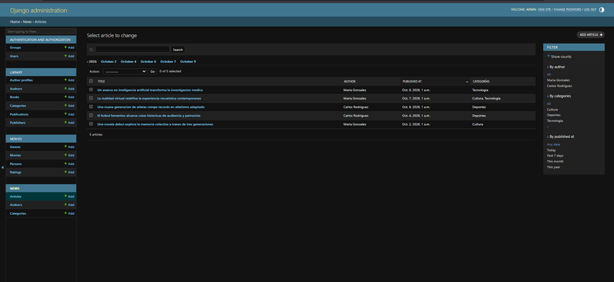
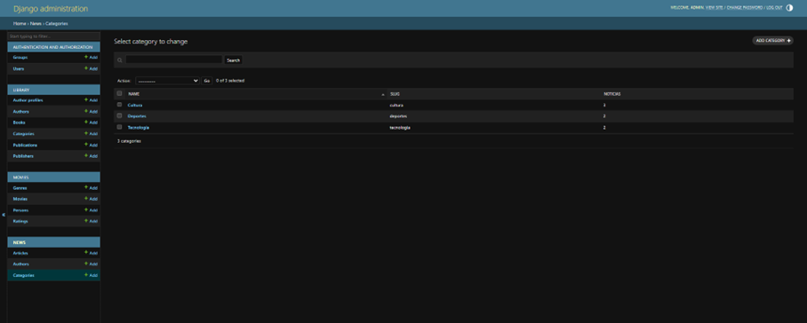
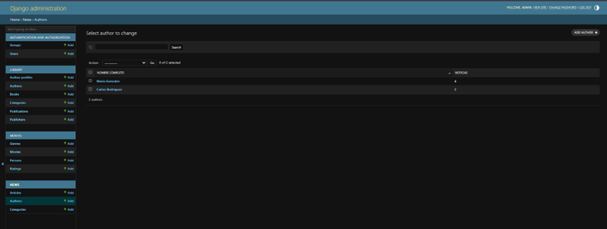
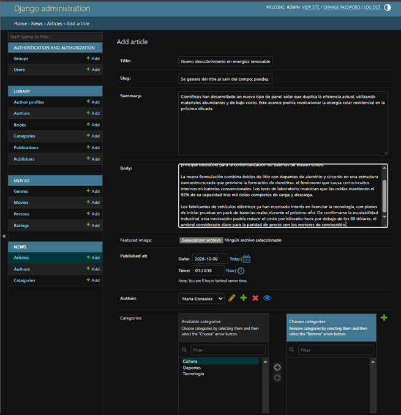
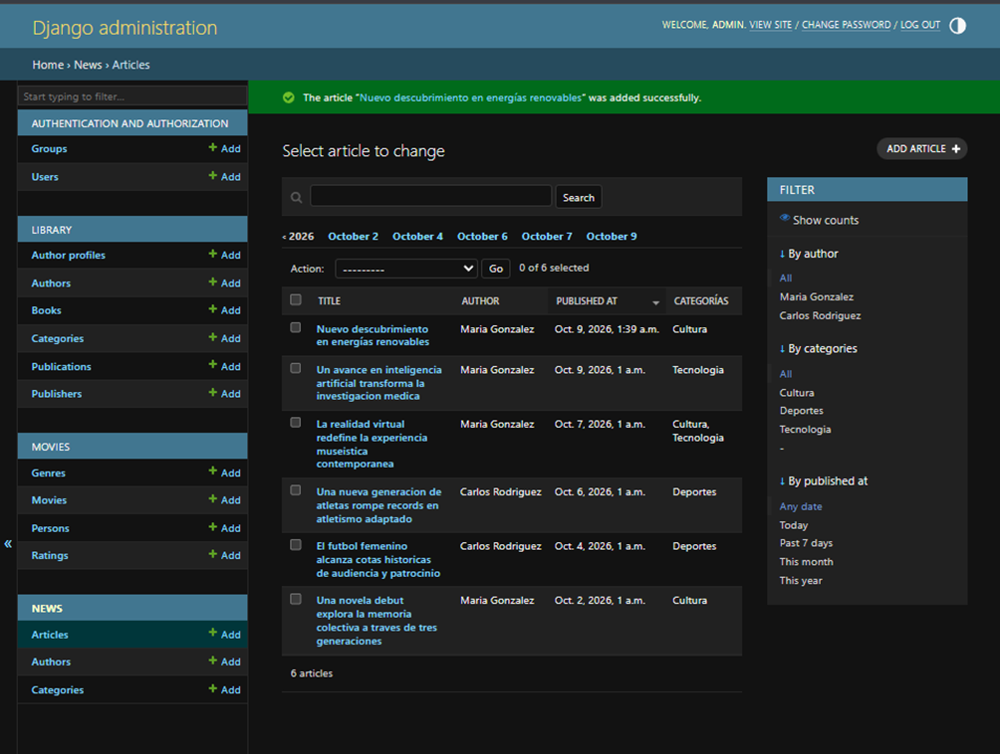
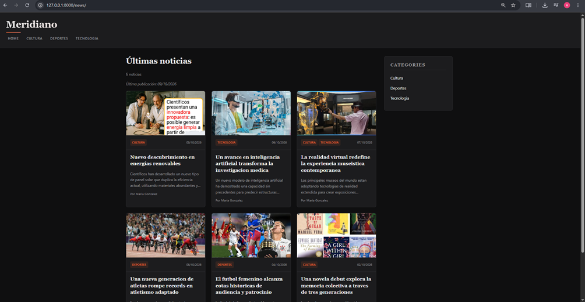
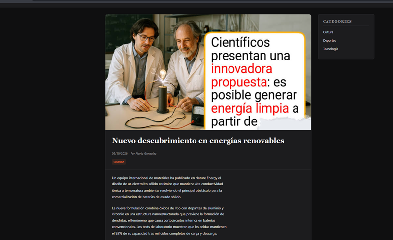
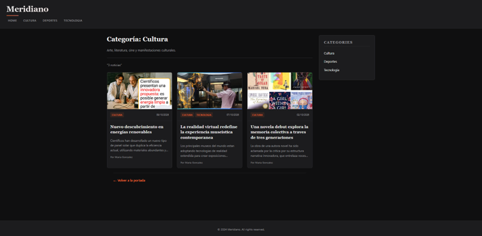
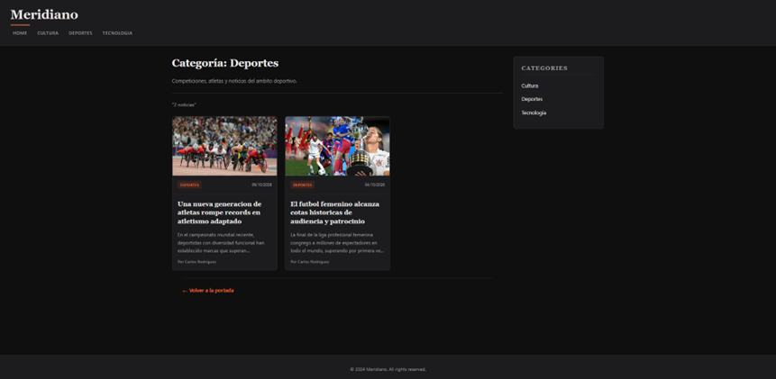
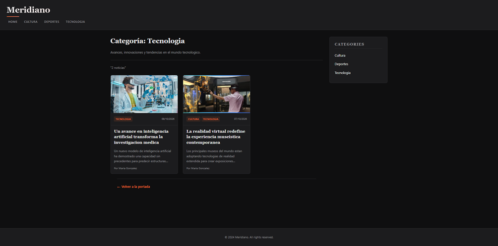

# Meridiano News
## Autor
Alexander Faustino

**Laboratorio 6** — "Motor de plantillas con Django" del curso **Desarrollo de Aplicaciones Empresariales**.

App `news`: portal de noticias "Meridiano" con herencia de plantillas, fragmentos reutilizables, diseño editorial oscuro y panel de administración personalizado.

---

## Descripción

Aplicación **news** independiente que se integra en un proyecto Django existente (convive con `library` y `movies` sin modificarlas).

### Portal público (sin login) — `/news/`

| Página | Qué muestra |
|--------|-------------|
| **Portada** `/news/` | Hero (noticia destacada) + grid de tarjetas + sidebar con categorías |
| **Detalle** `/news/article/<slug>/` | Imagen destacada, título, meta (fecha/autor), categorías (links), cuerpo con párrafos, author-box, "Volver a la portada" |
| **Categoría** `/news/category/<slug>/` | Listado filtrado (2 por categoría), reutiliza fragmento `_article_card.html` |

### Panel de administración — `/admin/news/`

| Modelo | Personalización |
|--------|-----------------|
| `Author` | `list_display`: nombre completo, noticias (anotado); `search_fields`: first_name, last_name |
| `Category` | `list_display`: name, slug, noticias (anotado); `prepopulated_fields`: slug desde name; `search_fields`: name, description |
| `Article` | `list_display`: title, author, published_at, categorías; `list_filter`: author, categories, published_at; `search_fields`: title, summary, body; `prepopulated_fields`: slug desde title; `filter_horizontal`: categories; `date_hierarchy`: published_at; `list_select_related`: author |

---

## Modelo de datos

| Modelo | Campos clave | Relaciones |
|--------|--------------|------------|
| `Author` | `first_name`, `last_name`, `bio`, `photo` | — |
| `Category` | `name` (unique), `slug` (unique), `description` | — |
| `Article` | `title`, `slug` (unique), `summary`, `body`, `featured_image`, `published_at` | `author` → FK `Author` (`PROTECT`, `related_name="articles"`); `categories` → M2M `Category` (`related_name="articles"`) |

> **Justificaciones**: `PROTECT` evita borrar un autor con artículos publicados; M2M permite que un artículo esté en varias categorías y viceversa.

Esquema completo en [`docs/news-data-model-spec.md`](docs/news-data-model-spec.md).

---

## Capacidades demostradas

1. **Motor de plantillas con herencia y fragmentos**: `base.html` (bloques `title`, `content`, `sidebar`), fragmento `_article_card.html` reutilizado en portada y listado por categoría.
2. **Datos en plantillas sin lógica de negocio**: variables, `for`/`empty`, `if`, filtros `date`, `truncatewords`, `linebreaks`; **sin `|safe` ni `autoescape off`**.
3. **Gestión de contenido desde el admin**: 3 categorías, 2 autores, 6 noticias (2 por categoría, al menos 1 en 2 categorías) dadas de alta en `/admin/news/` y publicadas en el portal.
4. **Escapado automático verificado**: HTML en body se muestra como texto plano (entidades); contraste con `|safe` solo documentado en shell.

---

## Estructura de plantillas

```
templates/
└── news/
    └── base.html              # Layout global: header, nav, main(content+sidebar), footer
news/
└── templates/
    └── news/
        ├── _article_card.html # Fragmento reutilizable (include)
        ├── home.html          # Portada: hero + grid + empty-state
        ├── article_detail.html# Detalle: imagen, meta, categorías, body|linebreaks, author-box
        └── category_detail.html # Listado por categoría: reutiliza _article_card.html
```

**Por qué reutilizar `_article_card.html`**: DRY, consistencia visual, mantenimiento único, separación presentación/lógica.

---

## Estilos — "Revista editorial oscura"

- **Archivo**: `news/static/news/style.css` (cargado con ``)
- **Variables CSS** (`:root`):
  - Fondo `#0f0f10`, superficies `#1c1c1e`, texto `#ececec`, texto atenuado `#9a9a9f`
  - Acento naranja `#ff6b35`, acento coral `#ff7f6b`, borde `#2a2a2d`
- **Tipografía**: Titulares **serif** (Georgia, "Times New Roman"), cuerpo **sans-serif** del sistema (system-ui, -apple-system, Segoe UI)
- **Layout**: Cabecera tipo revista, hero + grid responsive (`auto-fill, minmax(280px, 1fr)`), sidebar 280px
- **Componentes**: Tarjetas con hover elevation, categorías como badges naranja, fallback degradado sin imagen, author-box con borde izquierdo de acento
- **Responsive**: Breakpoints 1024px, 768px, 480px
- **Sin frameworks ni fuentes externas por CDN**

---

## URLs

| Patrón | Nombre | Descripción |
|--------|--------|-------------|
| `/news/` | `news:home` | Portada |
| `/news/article/<slug>/` | `news:article_detail` | Detalle de noticia |
| `/news/category/<slug>/` | `news:category_detail` | Listado por categoría |

Todas las URLs en plantillas usan `` (ninguna hardcodeada).

---

## Datos de prueba (cargados vía admin)

- **3 Categorías**: Tecnología (`tecnologia`), Deportes (`deportes`), Cultura (`cultura`)
- **2 Autores**: María González, Carlos Rodríguez (con bio)
- **6 Noticias**: 2 por categoría, la #2 (Realidad virtual) en Tecnología + Cultura
- **Imágenes**: 5 archivos en `media/articles/` (tech-ia.PNG, tech-cultura.PNG, deporte1.PNG, deporte2.PNG, cultura.PNG)

---

## Verificación de escapado (Paso 12)

- Noticia de prueba con `<script>alert('xss')</script> <b>bold</b>` en el body → se renderiza como **texto plano** (entidades escapadas)
- Contraste con `|safe` documentado solo en shell/docs, **nunca en plantillas**

---

## Sub-agentes usados (OpenCode)

| Sub-agente | Encargado de |
|------------|--------------|
| `news-project-structure` | Crear app `news`, instalar Pillow, `INSTALLED_APPS` |
| `news-settings` | `TEMPLATES[DIRS]`, estáticos, medios (sin duplicar) |
| `news-models` | Modelos `Author`, `Category`, `Article` + migraciones |
| `news-base-template` | `templates/news/base.html` con bloques |
| `news-partials` | `news/templates/news/_article_card.html` |
| `news-pages` | Vistas y plantillas: home, detail, category |
| `news-urls` | `app_name="news"`, 3 rutas, include en `config/urls.py` ANTES de raíz |
| `news-static-design` | `news/static/news/style.css` diseño oscuro responsive |
| `news-admin` | `ModelAdmin` personalizado + carga de 6 noticias |
| `news-escaping` | Prueba autoescape + documentación |
| `news-documentation` | Entregable formato curso |

---

## Instalación y uso

```bash
# 1. Clonar
git clone <url-del-repositorio>
cd Lab04-DAE

# 2. Entorno virtual
python -m venv venv
venv\Scripts\activate        # Windows
source venv/bin/activate     # Linux / macOS

# 3. Dependencias
pip install -r requirements.txt

# 4. Migraciones
python manage.py migrate

# 5. Superusuario (si no existe)
python manage.py createsuperuser

# 6. Servidor
python manage.py runserver
```

### URLs principales

| URL | Descripción |
|-----|-------------|
| `http://127.0.0.1:8000/news/` | Portada Meridiano |
| `http://127.0.0.1:8000/news/article/<slug>/` | Detalle noticia |
| `http://127.0.0.1:8000/news/category/<slug>/` | Listado por categoría |
| `http://127.0.0.1:8000/admin/` | Panel de administración (News, Movies, Library) |

---

## Capturas para la entrega


**Panel de admin**












**Sitio web**









